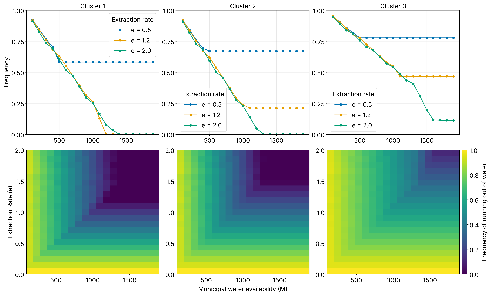

# Household Piped-Water Deficit Model: reproducible code

Code to reproduce the model results and figures of

> **Modelling Urban Household Water Deficits in Intermittent Water Supply System**, Gadge S., Vasconcelos V., Krueger E., Submitted to Environmental Modelling and Software, 2026. DOI: to be added upon publication

The model is a *representative-agent* simulation of piped water supplied intermittently to
households that own storage tanks, informed by household-survey data from Amman, Jordan. A hierarchical 
clustering analysis resulted in household clusters (refer to https://doi.org/10.1016/j.cacint.2026.100337). Each cluster is represented by its mean (per household) demand,
storage size and supply duration by the respective model agent. The model is then used to explore how often households run out
of water under different combinations of extraction rates, municipal-water availability, supply durations, and
**simultaneous vs sequential** supply schedules, to understand urban household water deficits. The sensitivity of water deficits to different parameters
is understood using a global (Sobol) sensitivity analysis.



## Quick start

```bash
git clone [this repo] && cd [this repo]
python -m venv .venv && source .venv/bin/activate
pip install -e ".[dev]"

pytest                       # model equals the original notebook code, bit for bit
bash scripts/run_all.sh      # every figure -> results/   (~3 min incl. Sobol, N=1024)
bash scripts/run_all.sh 32   # quick smoke test
```

No private data are needed: the model starts from the **cluster-level aggregates** in
[`data/cluster_parameters.csv`](data/cluster_parameters.csv) (see [`data/README.md`](data/README.md)).

```python
from supplymodel import load_cluster_parameters, simulate

P = load_cluster_parameters()                         # per-cluster n, d, K, s
out = simulate(extraction=1.2, municipal_water=800, start_days=[0, 2, 4], **P.model_kwargs())
out.deficit_frequency                                 # shape (1, 3): share of time with empty storage
```

## The model

One representative household per cluster `i`, forward-Euler with `dt = 0.1` day for 101 weeks:

| | |
|---|---|
| storage state `v_i` | `dv_i/dt = (e_i - D_i) / K_i`, capped at 1 |
| extraction `e_i` | `e` if `v_i < 1` and supply is on for cluster `i` and `w > 0`, else `0` |
| use `D_i` | `d_i` if `v_i > 0`, else `0` |
| municipal water `w` | `dw/dt = - sum_i n_i e_i / M`; reset to 1 at the start of every week |
| **outcome** | share of time steps with `D_i = 0` ("frequency of running out of water") |

Supply `S_i(t)` is a binary weekly signal that is on for `s_i` days. *Simultaneous* supply starts all
clusters on day 0; *sequential* supply starts them `gap = 2` days apart (e.g. order 1-2-3 -> start days 0, 2, 4).

| symbol | code | meaning |
|---|---|---|
| `e` | `extraction` | extraction rate |
| `M` | `municipal_water` | municipal water availability |
| `K` | `storage` | storage size (m³) |
| `d/D` | `demand` | daily demand (use) (m³/day) |
| `s` | `supply_days` | supply duration (days/week) |
| `n` | `households` | households per cluster |

## Repository layout

```
data/                      cluster_parameters.csv  (+ README: how to define / regenerate it)
src/supplymodel/
    model.py               equations, supply signal, simulator (batched, exact)
    data.py                load aggregates, or aggregate clustered household data
    sweeps.py              e-vs-M, e-vs-supply-duration, relative-extraction sweeps
    sensitivity.py         Sobol analysis (SALib)
    plotting.py            shared figure style
scripts/                   one script per figure
scripts/sensitivity/       Sobol runs + plots
tests/                     equivalence with the original notebook loop, regression tests
docs/notebook_mapping.md   which notebook section became which script
```

## Reproducing the figures

| Script | Output (in `results/`) | What it shows |
|---|---|---|
| `fig_cluster_characteristics.py` | `cluster_characteristics.png/.pdf` | cluster means (± SEM if household data supplied) |
| `fig_supply_scenarios.py` | `binary_curves.png` | simultaneous vs sequential supply schedules |
| `fig_deficit_e_vs_M.py` | `Composite_PS_eMx.png`, `PS-eM-total.png` | deficit frequency vs `e` and `M`; population-level deficit (% of households) |
| `fig_deficit_e_vs_supply_duration.py` | `Composite_S_vs_frequencyx.png` | deficit frequency vs `e` and supply duration |
| `fig_sequential_orders_e_vs_M.py` | `heatmap_selected_permutationsticks.png` | sequential supply, orders 1-2-3, 1-3-2, 3-1-2 |
| `fig_sequential_relative_extraction.py` | `all_orders_relative_extraction.png` | permutations of relative extraction rates across clusters (supplement) |
| `fig_sequential_all_orders_e_vs_duration.py` | `heatmap_duration_*.png` | all 6 supply orders, `e` vs supply duration (supplement) |
| `sensitivity/run_sobol.py` + `plot_sobol_simultaneous.py` | `Sobol_S1_ST_simultaneous_N1024.png` | S1 / ST indices, simultaneous supply |
| `sensitivity/run_sobol.py --mode orders` + `plot_sobol_orders.py` | `Sobol_ST_all_clusters.png` | ST per parameter across 7 supply schedules |

Raw sweep arrays are also saved (`.npy`/`.json`) so figures can be re-styled without re-simulating.
All scripts accept `--params <csv>`, `--out <dir>`, `--show`.

## Sensitivity analysis

Sobol indices (first, second and total order; Saltelli sampling, `seed=123`) for five inputs of one
focal cluster at a time (all other clusters at baseline `e = 1`, `M = 1100`, cluster-mean `K, d, s`):
extraction rate `[0, 2]`, `M` `[100, 2000]`, `K` `[0.5·min, 1.5·max]`, `d` `[0.5·min, 1.5·max]`, `s` `[1, 7]`.
The batched simulator makes `N = 1024` (12,288 runs per cluster and schedule) take about 15 s per schedule.

## Performance note

`simulate` evaluates many parameter sets at once with NumPy, applying exactly the same arithmetic as
the original scalar loops. `tests/test_model.py` checks equality against a verbatim copy of the
notebook code (`tests/reference_notebook_impl.py`).

## Citation

See [`CITATION.cff`](CITATION.cff).

## License

Code: MIT (see `LICENSE`).
